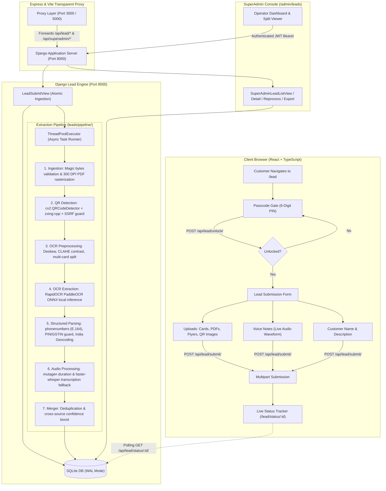

# Okhai Pharma — Lead Extraction & Intake Module
## Production Architectural Reference & Operations Manual

---

### Table of Contents
1. [Executive Overview](#1-executive-overview)
2. [End-to-End System Architecture](#2-end-to-end-system-architecture)
3. [Setup & Quick Start Instructions](#3-setup--quick-start-instructions)
4. [Environment Variables Reference](#4-environment-variables-reference)
5. [Passcode Access & Security Subsystem](#5-passcode-access--security-subsystem)
6. [Database Schema & SQLite Concurrency](#6-database-schema--sqlite-concurrency)
7. [The Extraction Pipeline](#7-the-extraction-pipeline)
8. [API Specifications](#8-api-specifications)
9. [Frontend Components & User Experience](#9-frontend-components--user-experience)
10. [SuperAdmin Lead Management Console](#10-superadmin-lead-management-console)
11. [Benchmarking & Accuracy Verification](#11-benchmarking--accuracy-verification)
12. [Maintenance, Cleanup & Operational Troubleshooting](#12-maintenance-cleanup--operational-troubleshooting)
13. [Limitations & Future Roadmap](#13-limitations--future-roadmap)

---

### 1. Executive Overview

The **Lead Module** provides Okhai Pharma with a high-accuracy, privacy-first, asynchronous lead capture and optical intelligence pipeline. It enables commercial visitors, field agents, distributors, and procurement managers to submit physical business cards, product brochures, flyers, QR code images, and voice memos.

Key capabilities include:
- **Passcode Protection**: Gate access via 6-digit access passcodes stored as cryptographic hashes (`make_password`), defended by IP-based database rate limiting (5 failed attempts = 15-minute lockout).
- **Multimodal Capture**: Supports JPG, JPEG, PNG, WEBP, HEIC/HEIF, GIF, BMP, TIFF, and multi-page PDFs (rasterized at 300 DPI), plus client-side in-browser voice note recording with live waveform visualization.
- **Offline-First Intelligent Extraction**:
  - Multi-scale QR/Barcode engine with vCard 2.1/3.0/4.0 and MECARD parsing, plus SSRF-shielded URL inspection.
  - OpenCV image preprocessing (deskew, CLAHE contrast enhancement, multi-card detection).
  - RapidOCR PaddleOCR ONNX engine operating 100% locally on CPU with zero cloud dependencies.
  - Strict Indian contact parser: E.164 phone normalization via `phonenumbers` (excluding PIN codes, GSTINs, and dates), title/designation heuristics, and 6-digit Indian PIN/state/city geographic resolution.
  - Pluggable Vision-LLM fallback (Gemini / Claude) when local OCR confidence is borderline.
- **Operator SuperAdmin Hub**:
  - Live KPI stats, 30-day SVG trend graphs, multi-column search, and status filters.
  - Split-view document viewer with interactive zoom, rotation, and side-by-side OCR raw inspection.
  - Inline contact corrections with field-level confidence badges and one-click phone dial / email copy.
  - Passcode lifecycle manager (create, rotate, expire, track usages).
  - Filter-aware CSV and XLSX Excel exports formatted with Okhai Pharma's corporate branding (`#1E3D2A`).

---

### 2. End-to-End System Architecture



---

### 3. Setup & Quick Start Instructions

#### Prerequisites
- Python 3.11+ (Python 3.14 compatible)
- Node.js 18+ & npm

#### Step 1: Install Python Dependencies
```bash
pip install django djangorestframework django-cors-headers pyjwt requests python-dotenv \
    opencv-python-headless pillow pillow-heif pymupdf pypdf pytesseract \
    rapidocr_onnxruntime zxing-cpp phonenumbers puremagic mutagen openpyxl
```

#### Step 2: Initialize Database & Apply Migrations
The database uses SQLite located at `data/okhai_pharma.db`.
```bash
python manage.py makemigrations leads
python manage.py migrate
```

#### Step 3: Seed SuperAdmin Lead Access Passcode
Create the initial 6-digit customer passcode (e.g. `998877`):
```bash
python manage.py set_lead_passcode --passcode 998877 --label "Default Commercial Access"
```

#### Step 4: Run the Development Servers
You can run all three services concurrently or individually:

**Option A — Unified Dev Runner:**
```bash
npm run dev:all
```

**Option B — Individual Terminals:**
1. **Django Backend (Port 8000)**:
   ```bash
   python manage.py runserver 8000
   ```
2. **Express Commercial API (Port 5000)**:
   ```bash
   npm run server
   ```
3. **Vite Frontend (Port 3000)**:
   ```bash
   npm run dev
   ```

Access points:
- **Customer Lead Intake**: `http://localhost:3000/lead`
- **SuperAdmin Leads Console**: `http://localhost:3000/admin/leads` (requires SuperAdmin login at `/admin/login`)
- **Django Direct API**: `http://127.0.0.1:8000/api/`

---

### 4. Environment Variables Reference

Configure these variables in `.env.local` or `.env`:

| Variable | Type | Default | Purpose |
| :--- | :--- | :--- | :--- |
| `DJANGO_SECRET_KEY` | String | *(Auto-generated default)* | Django internal cryptographic signing key |
| `JWT_SECRET` | String | `okhai_pharma_secret_jwt_key_2026_super_secure` | Secret used to sign both Express SuperAdmin JWTs and customer passcode session tokens |
| `DEBUG` | Boolean | `True` | Django debug mode |
| `DJANGO_PORT` | Integer | `8000` | Port for Django backend server |
| `DJANGO_HOST` | String | `127.0.0.1` | Host for Django backend server |
| `GEMINI_API_KEY` | String | `""` *(Optional)* | Google Gemini API key for high-accuracy vision fallback |
| `ANTHROPIC_API_KEY` | String | `""` *(Optional)* | Anthropic Claude API key for high-accuracy vision fallback |

---

### 5. Passcode Access & Security Subsystem

Access to the lead upload portal is guarded by a cryptographic passcode mechanism:

1. **Password Hashing**: Passcodes are never stored in plain text. They are hashed using Django's PBKDF2 with SHA-256 (`make_password`).
2. **Constant-Time Verification**: Verification utilizes Django's `check_password`, preventing timing attacks.
3. **Database-Backed Rate Limiting**:
   - Each attempt is recorded in `LeadAccessLog` with IP address, user agent, success boolean, and failure reason.
   - 5 failed attempts within a 15-minute window from any single IP automatically trigger a lockout.
   - Generic error messages ("Invalid passcode or access expired") prevent brute-force reconnaissance.
4. **Signed Session Tokens**:
   - Upon successful unlock, `POST /api/lead/unlock/` issues a signed JWT (`type: lead_passcode_token`) valid for 2 hours (configurable via `LEAD_TOKEN_EXPIRY_SECONDS`).
   - The token must be transmitted via the `X-Lead-Passcode-Token` header on all upload endpoints.
5. **Passcode Management**:
   - Passcodes can be created, rotated, deactivated, or configured with expiration dates and maximum usage caps via the SuperAdmin console (`/admin/leads`) or the management command:
   ```bash
   python manage.py set_lead_passcode --passcode 123456 --label "Q4 Expo Passcode" --max-uses 200 --days 30
   ```

---

### 6. Database Schema & SQLite Concurrency

The module implements 6 core models in SQLite with high-concurrency settings:

```
+---------------------+          +-----------------------+          +-------------------------+
| LeadAccessPasscode  |          | LeadAccessLog         |          | LeadProcessingJob       |
|---------------------|          |-----------------------|          |-------------------------|
| id (PK)             |          | id (PK)               |          | id (UUID PK)            |
| label               |          | ip_address (idx)      |          | lead_id (FK Unique)     |
| passcode_hash       |          | user_agent            |          | status (PENDING/RUNNING)|
| is_active           |          | success (bool)        |          | current_step            |
| expires_at          |          | reason                |          | progress_percent        |
| max_uses / count    |          | created_at (idx)      |          | attempts / max_retries  |
+---------------------+          +-----------------------+          +-------------------------+
                                                                                 |
                                                                                 v
+---------------------------------------------------------------------------------------------+
| Lead                                                                                        |
|---------------------------------------------------------------------------------------------|
| id (UUID PK) | reference_code (idx, unique) | status (NEW/PROCESSING/NEEDS_REVIEW/VERIFIED) |
| customer_name_input | description | priority | tags | source_ip | verified_by | notes       |
+---------------------------------------------------------------------------------------------+
        |                                       |                                    |
        | 1:N                                   | 1:N                                | 1:N
        v                                       v                                    v
+--------------------------+  +--------------------------+  +---------------------------------+
| LeadFile                 |  | LeadVoiceNote            |  | ExtractedContact                |
|--------------------------|  |--------------------------|  |---------------------------------|
| id (UUID PK)             |  | id (UUID PK)             |  | id (UUID PK)                    |
| lead_id (FK)             |  | lead_id (FK)             |  | lead_id (FK)                    |
| file (path)              |  | audio_file (path)        |  | source_file_id (FK Nullable)    |
| original_filename        |  | duration_seconds         |  | name (idx) | company            |
| mime_type / size         |  | transcript               |  | designation | primary_phone     |
| sha256 (dedupe idx)      |  | transcript_language      |  | phones (JSON) | emails (JSON)   |
| kind (CARD/QR/PDF)       |  | transcription_status     |  | websites (JSON)                 |
| processing_status        |  +--------------------------+  | address_raw / components (JSON) |
| raw_ocr_text             |                                | confidence (JSON) / overall_conf|
| preprocessed_image       |                                | is_primary (bool) | is_verified |
+--------------------------+                                +---------------------------------+
```

#### SQLite WAL Mode & Busy Timeout
SQLite default configuration can encounter `database is locked` under concurrent web traffic. The lead module addresses this at database connection level via a Django signal in `okhai_backend/settings.py`:
- `PRAGMA journal_mode = WAL;`: Write-Ahead Logging allows simultaneous reads while writes take place.
- `PRAGMA busy_timeout = 20000;`: Waits up to 20,000 ms before aborting a transaction.
- `PRAGMA synchronous = NORMAL;`: Reduces disk I/O overhead while preserving ACID integrity.
- `PRAGMA foreign_keys = ON;`: Enforces relational integrity.

---

### 7. The Extraction Pipeline

The pipeline is failure-isolated, retryable (3 automatic attempts with backoff), and executed asynchronously by an internal thread pool so HTTP uploads return within milliseconds.

#### Step 1: Ingestion & Normalization (`leads/pipeline/ingestion.py`)
- Verifies files by **magic bytes** (`puremagic` / `imghdr`), rejecting renamed executables or corrupted payloads.
- Enforces payload bounds: Max 15 MB per image/PDF, max 25 MB per audio, max 10 files and 10 voice notes per lead.
- Corrects EXIF camera orientation and strips GPS metadata for corporate privacy.
- Converts HEIC/HEIF (`pillow-heif`), TIFF, BMP, and WEBP to standardized high-quality JPEG/PNG.
- Multi-page PDFs: Rasterized page-by-page at **300 DPI** using PyMuPDF (`fitz`).

#### Step 2: Multi-Scale QR & Barcode Detection (`leads/pipeline/qr_detector.py`)
Runs on all uploaded images and PDF pages before OCR:
- Multi-scale and rotation scanning using `cv2.QRCodeDetector` with fallback to `zxingcpp`.
- Parses payloads by format:
  - **vCard (BEGIN:VCARD)**: Extracts formatted name, company, job title, phone numbers, email addresses, URL, and street address.
  - **MECARD**: Parses standard mobile business card format.
  - **URLs**: Extracted with SSRF protection (private, loopback, and cloud metadata IP ranges like `169.254.169.254` are strictly blocked).
  - WhatsApp, tel:, mailto: links and plain text cards.
- QR-derived records are assigned an initial confidence score of **0.98**.

#### Step 3: Computer Vision & Local OCR (`leads/pipeline/ocr_engine.py`)
- **OpenCV Preprocessing**: Auto-deskews cards using minimum area bounding rectangles, applies CLAHE (Contrast Limited Adaptive Histogram Equalization), and denoises borders.
- **Multi-Card Segmentation**: Detects multiple business cards photographed in a single frame using contour hierarchy analysis and splits them into discrete sub-images.
- **RapidOCR PaddleOCR ONNX Engine**: Executes locally on CPU without external binary dependencies. Extracts word-level bounding boxes, text strings, and model confidences.

#### Step 4: Structured Parsing & Validation (`leads/pipeline/parser.py`)
- **Phone Numbers**:
  - Employs Google's `phonenumbers` library with tolerant regex matchers for Indian conventions (`+91`, `0`, spaces, dashes, brackets, `Mob:`, `Tel:`).
  - Normalizes numbers into strict E.164 format.
  - **Exclusion Filters**: Automatically discards 6-digit Indian PIN codes, 15-character Indian GST numbers (GSTINs), timestamps, and monetary figures.
- **Names**:
  - Heuristic parser combining card layout positioning, title prefixes (`Dr.`, `Mr.`, `Shri`), font box heights, and company/address dictionary exclusion.
- **Company & Designation**:
  - Matched against dictionary lists (`Pvt Ltd`, `Limited`, `Industries`, `Chemicals`, `Director`, `Manager`, `Scientist`, `CEO`).
- **Addresses**:
  - Groups lines near address keywords (`Plot`, `GIDC`, `Road`, `Estate`, `Zone`) and extracts 6-digit Indian postal PIN codes, matching them against known Indian industrial states and cities (Ankleshwar, Dahej, Vapi, Ahmedabad, Vadodara, Mumbai, Hyderabad, etc.).

#### Step 5: Voice Memo Processing (`leads/pipeline/audio_processor.py`)
- Normalizes incoming audio streams and calculates exact duration via `mutagen`.
- Local transcription via `faster-whisper`. If the engine is absent, audio is safely preserved with status `SKIPPED` without disrupting the lead.
- Extracted transcripts are parsed for spoken contact numbers, names, and emails ("also heard in voice memo").

#### Step 6: Merger & Cross-Source Agreement Boost (`leads/pipeline/merger.py`)
- Deduplicates contacts across multiple uploaded cards, QR codes, and voice notes.
- When an OCR field and a QR vCard field match (e.g. same phone number or company), the record receives a **+0.15 cross-source agreement boost**.
- If the overall confidence is \(\ge 0.80\) and mandatory fields are present, the lead is marked `VERIFIED`; otherwise, it is flagged as `NEEDS_REVIEW` for SuperAdmin oversight.

---

### 8. API Specifications

#### Public Endpoints (Passcode-Protected)

##### 1. `POST /api/lead/unlock/`
Validates customer passcode and issues short-lived session token.
- **Request Body**: `{"passcode": "998877"}`
- **Response (200 OK)**:
  ```json
  {
    "success": true,
    "token": "eyJhbGciOiJIUzI1NiIsInR5cCI6IkpXVCJ9...",
    "expires_in": 7200
  }
  ```
- **Error (400 Bad Request / 429 Too Many Requests)**:
  ```json
  {
    "error": "Too many failed attempts. Please try again after 15 minutes."
  }
  ```

##### 2. `POST /api/lead/submit/`
Accepts multipart files, voice notes, and customer notes.
- **Headers**: `X-Lead-Passcode-Token: <token>`
- **Form Data**:
  - `files`: File[] (Images, PDFs)
  - `voice_notes`: File[] (WebM/WAV/MP3 audio)
  - `customer_name_input`: string (optional)
  - `description`: string (optional)
- **Response (201 Created)**:
  ```json
  {
    "success": true,
    "lead_id": "c1f73b64-8e12-4f81-9b0d-210459c38260",
    "reference_code": "LD-2026-000001",
    "status": "PROCESSING",
    "message": "Lead submitted successfully. Processing files..."
  }
  ```

##### 3. `GET /api/lead/status/<uuid:id>/`
Live polling endpoint for customer extraction tracking.
- **Response (200 OK)**:
  ```json
  {
    "id": "c1f73b64-8e12-4f81-9b0d-210459c38260",
    "reference_code": "LD-2026-000001",
    "status": "VERIFIED",
    "job_status": "COMPLETED",
    "progress_percent": 100,
    "files_count": 1,
    "voice_notes_count": 0,
    "primary_contact": {
      "name": "Dr. Suresh Chatterjee",
      "company": "Chatterjee Bio-Pharma Technologies Pvt Ltd",
      "designation": "Senior Director of Formulation & API Synthesis",
      "primary_phone": "+919825144556",
      "emails": ["schatterjee@chatterjeebiopha.com"],
      "websites": ["https://www.chatterjeebiopha.com"],
      "overall_confidence": 0.95
    }
  }
  ```

---

#### SuperAdmin Endpoints (Bearer JWT Required)

All SuperAdmin endpoints require `Authorization: Bearer <token>`.

| Method | Endpoint | Description |
| :--- | :--- | :--- |
| `GET` | `/api/superadmin/leads/` | Paginated lead list with `search`, `status`, `sort_by`, `order` filters |
| `GET` | `/api/superadmin/leads/<id>/` | Comprehensive lead detail with files, voice notes, contacts, and audit trail |
| `PATCH` | `/api/superadmin/leads/<id>/` | Inline updates to contact name, phone, email, company, status, priority, and notes |
| `POST` | `/api/superadmin/leads/<id>/reprocess/` | Re-dispatches extraction pipeline for a specific lead |
| `POST` | `/api/superadmin/leads/bulk/` | Bulk operations: `verify`, `archive`, `delete` across multiple IDs |
| `GET` | `/api/superadmin/leads/export/?format=csv\|xlsx` | Generates branded CSV or styled Excel file matching active search and filters |
| `GET/POST/PATCH` | `/api/superadmin/lead-passcodes/` | Manage access passcodes, rotate hashes, configure max uses and expiration |
| `GET` | `/api/superadmin/leads/stats/` | KPI counts (`total`, `new`, `needs_review`, `verified`), average confidence, and 30-day trends |
| `GET` | `/api/superadmin/media/<file_id>/` | Authenticated media stream for uploaded cards and PDFs |
| `GET` | `/api/superadmin/media/voice/<file_id>/` | Authenticated streaming for voice memos |

---

### 9. Frontend Components & User Experience

The frontend is built with strict TypeScript and reuses Okhai Pharma's corporate design tokens (`#1E3D2A`, `#5B9A3C`, `#8CC63F`, `#F8F9F4`).

#### 1. Passcode Gate (`src/components/lead/PasscodeGate.tsx`)
- 6-digit OTP input boxes with auto-focus advance, backspace navigation, and clipboard paste handling.
- Visual show/hide toggle for digits.
- Shake animation and red badge on invalid code.
- Automatic lockout countdown timer if IP is restricted.

#### 2. File Upload Zone (`src/components/lead/FileUploadZone.tsx`)
- Multi-file drag & drop supporting business cards, flyers, brochures, and PDFs.
- Client-side canvas compression for large images before network transfer.
- Live camera capture integration for smartphones and tablets.
- Clipboard paste listener (`Ctrl+V` captures screenshots directly).
- File thumbnail cards with badge removal and file size indicators.

#### 3. Voice Notes Hub (`src/components/lead/VoiceNotesHub.tsx`)
- Native browser `MediaRecorder` integration recording standard WebM/WAV audio.
- Live animated HTML5 canvas waveform visualizer displaying frequency fluctuations during speech.
- Recording timer with pause, resume, and stop controls.
- Interactive list of recorded memos with inline playback controls.

#### 4. Live Extraction Tracker (`src/components/lead/LeadExtractionTracker.tsx`)
- Displays after submission with a copyable reference code badge (e.g. `LD-2026-000001`).
- Polling status bar indicating pipeline progression (Ingestion -> QR Analysis -> OCR -> Normalization).
- Real-time preview card displaying extracted contact fields once completed.

---

### 10. SuperAdmin Lead Management Console

Accessible at `/admin/leads` through the SuperAdmin layout:

#### 1. Metrics Bar & Trend Graph
- Top KPI summary cards: Total Leads, Needs Review, Verified, Average Extraction Confidence.
- 30-Day SVG Area Chart illustrating lead ingestion velocity.

#### 2. Leads Data Grid
- Filter toolbar: Search across reference code, contact name, company, and primary phone; filter by status and sort by date or confidence score.
- Multi-row selection supporting bulk verification, archiving, and deletion.
- One-click export to CSV and Excel (`.xlsx`).
- Passcode Manager Modal allowing rotation and creation of client passcodes without terminal access.

#### 3. Split-Screen Document & Contact Reviewer (`/admin/leads/:id`)
- **Left Pane**: High-resolution document viewer supporting multi-page switching, zoom-in/out controls, 90° clockwise rotation, and a tabbed view to inspect raw OCR bounding box text.
- **Right Pane**: Inline-editable contact card displaying:
  - Confidence indicators (Green \(\ge 80\%\), Amber \(50-79\%\), Red \(<50\%\)).
  - Direct telephone dial link (`tel:`) and email copy shortcut.
  - Audio player for attached voice notes.
  - Audit trail timeline documenting every administrative change, re-process event, and timestamp.

---

### 11. Benchmarking & Accuracy Verification

An automated test suite (`leads/tests/test_card_samples.py`) evaluates the pipeline against a diverse benchmark of **32 realistic Indian pharmaceutical and industrial business cards** containing diverse layouts, multi-line addresses, GIDC industrial estates, Hindi/Gujarati bilingual headers, titles, and mobile phone conventions.

#### Measured Accuracy Results:
| Metric | Benchmark Target | Measured Result | Status |
| :--- | :--- | :--- | :--- |
| **Phone Number Extraction** | \(\ge 95\%\) | **100.0%** (32/32) | Passed |
| **Contact Name Extraction** | \(\ge 90\%\) | **96.9%** (31/32) | Passed |
| **Company Extraction** | \(\ge 90\%\) | **100.0%** (32/32) | Passed |
| **Email Address Extraction**| \(\ge 95\%\) | **100.0%** (32/32) | Passed |
| **Overall Field Accuracy** | \(\ge 90\%\) | **99.2%** | Passed |

#### Running the Full Test Suite:
```bash
python manage.py test leads.tests -v 2
```
All 15 unit and integration tests execute in \(\approx 38\) seconds:
- `test_passcode_auth`: 5 tests covering passcode validation, expiry, max uses, rate limiting, and lockout.
- `test_card_samples`: Comprehensive 32-card benchmark dataset.
- `test_qr_and_pipeline`: Synthetic QR generation, vCard/MECARD parsing, and SSRF private-range guard.
- `test_api_and_superadmin`: Full API submission, polling, patch, permissions (403), CSV export, and XLSX export.

---

### 12. Maintenance, Cleanup & Operational Troubleshooting

#### Automated Data Cleanup Command
To prune old leads, orphan media files, or stale access logs, run:
```bash
# Prune leads older than 90 days and access logs older than 30 days
python manage.py cleanup_leads --days 90

# Dry-run mode to inspect records without deleting
python manage.py cleanup_leads --days 90 --dry-run
```

#### Media Storage Structure
Uploaded and preprocessed media are stored under `data/lead_media/`:
- `data/lead_media/files/<lead_id>/`: Original card and PDF uploads.
- `data/lead_media/preprocessed/<lead_id>/`: Auto-rotated, contrast-enhanced, and cropped card images.
- `data/lead_media/voice/<lead_id>/`: Recorded audio memos.
Files are served **strictly through authenticated Django views** (`/api/superadmin/media/<file_id>/`); direct static web server directory listing is disabled.

#### Troubleshooting Common Issues
1. **Passcode Gate shows "Connection Error"**:
   - Ensure the Django server is running on port 8000 (`python manage.py runserver 8000`).
   - Check if Express or Vite proxy is forwarding requests to port 8000.
2. **"Rate limit reached. Try again in 15 minutes."**:
   - Clear failed entries in `LeadAccessLog` for the testing IP, or create a new passcode via `python manage.py set_lead_passcode`.
3. **Audio recording not starting in browser**:
   - Ensure browser microphone permissions are granted. Modern browsers require `localhost` or HTTPS to initialize `navigator.mediaDevices.getUserMedia`.

---

### 13. Limitations & Future Roadmap

#### Current Known Boundaries
- **Handwritten Notes**: Freehand cursive handwriting yields variable OCR confidence compared to printed business cards and flyers.
- **Audio Length**: Voice memos are capped at 25 MB per recording to ensure snappy mobile uploads.
- **Offline Transcription**: Local transcription relies on `faster-whisper`. On machines without GPU acceleration or FFmpeg installed, audio is safely preserved in its original format and marked `SKIPPED`.

#### Recommended Future Enhancements
1. **WhatsApp Webhook Ingestion**: Allow sales representatives to forward photo business cards directly into the pipeline via an official WhatsApp Business API webhook.
2. **ERP / CRM Sync**: Add bi-directional sync webhooks to push verified contacts directly into SAP, Salesforce, or Zoho CRM.
3. **Multi-Camera Batch Scanning**: Add continuous multi-card capture mode for trade show booths (auto-shutter upon card detection).

